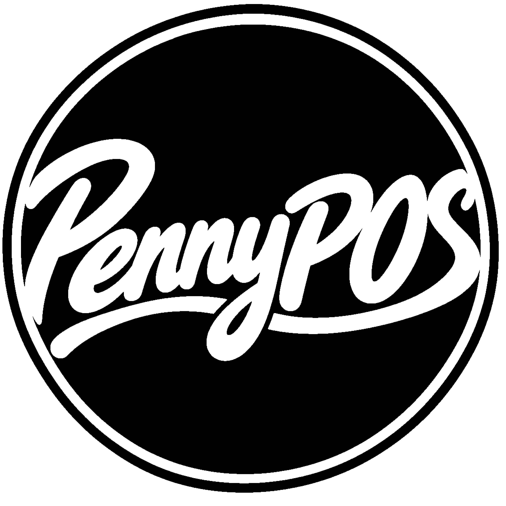

# PennyPOS

### Sistema de Gestão de Restaurantes

[Visão Geral](#visão-geral) · [Funcionalidades](#funcionalidades) · [Tecnologias](#tecnologias) · [Arquitetura](#arquitetura) · [Configuração](#configuração)

---

## Sobre o Projeto

A PennyPOS é uma aplicação web desenvolvida no âmbito da Prova de Aptidão Profissional (PAP), destinada à gestão e organização das operações diárias de estabelecimentos de restauração.
